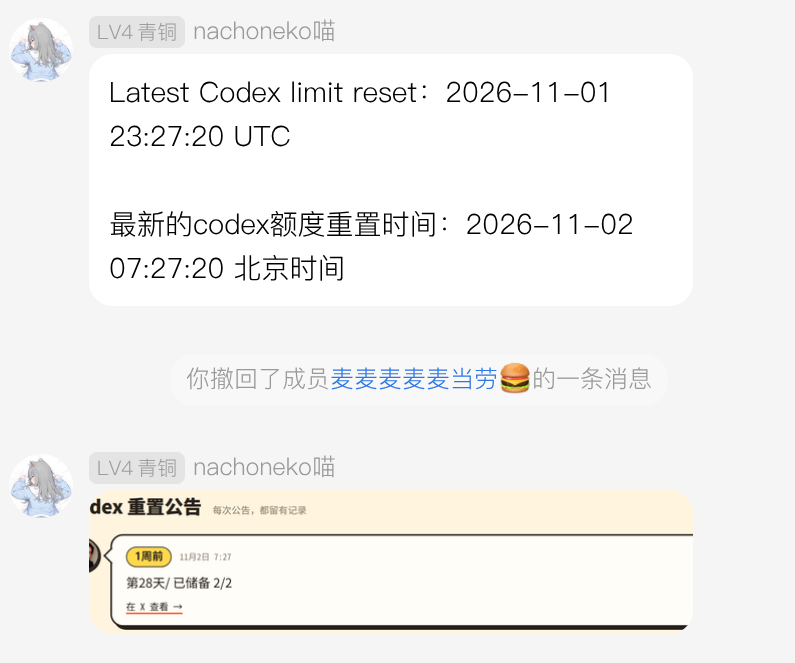

# Codex 额度重置通知插件

发送内容示例:

```text
Latest Codex limit reset：2026-08-31 02:29:25 UTC

最新的codex额度重置时间：2026-08-31 10:29:25 北京时间
```



- 可用 /reset 进行手动触发
- 截图由Chrome/Chromium 截图实现
- 目前重置通知url目前来自：https://codex-resets.com/


## 截图依赖

插件需要 `playwright` 以及可用的 Chrome/Chromium。插件会优先自动寻找系统中的 Google Chrome 或 Chromium；如果没有系统浏览器，请为当前 Python 环境安装 Playwright Chromium：

```bash
uv run playwright install chromium
```


## 配置

- `group_whitelist`：允许接收通知的 QQ 群列表。每条配置包含 `group_id`（群号）和 `only_reset`（仅接受 `/reset`，默认 `false`）。
- 每个群的 `only_reset` 独立生效。开启的群只接受 `/reset` 命令（支持前导 @ 当前机器人），忽略普通消息、图片、语音及其他命令；自动重置通知仍正常发送。其他群和私聊不受影响，插件禁用时不拦截消息。
- `private_whitelist`：允许接收通知的 QQ 用户号。
- `notify_on_first_run`：默认为 `false`，第一次运行插件是否进行一次通知

在插件的 `config.toml` 中配置，例如：

```toml
[whitelist]
group_whitelist = [
    { group_id = "123456789", only_reset = true },
    { group_id = "987654321", only_reset = false },
]
private_whitelist = []
```


